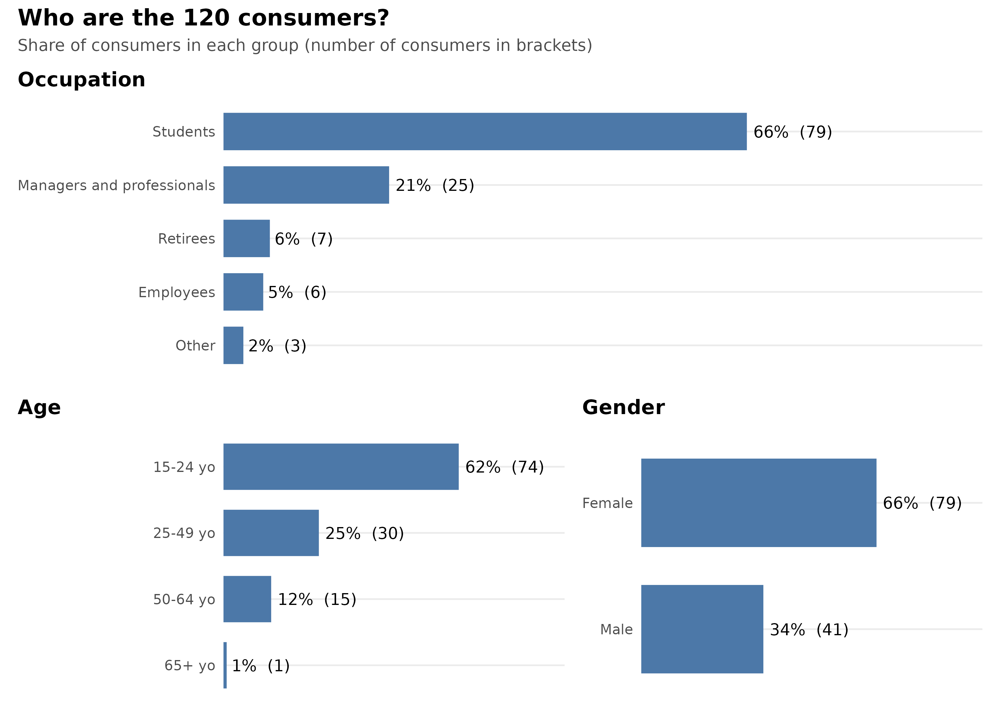
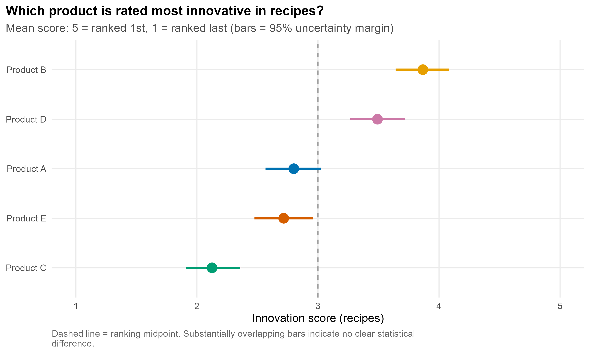
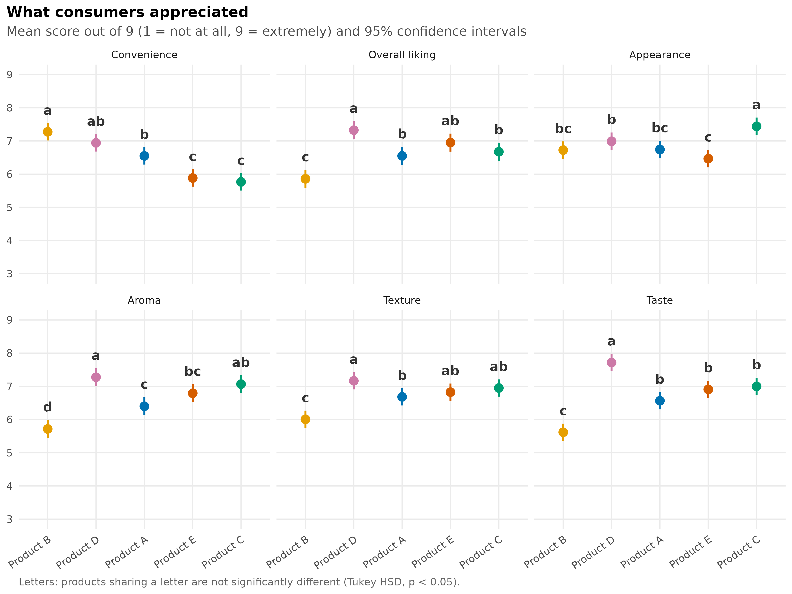
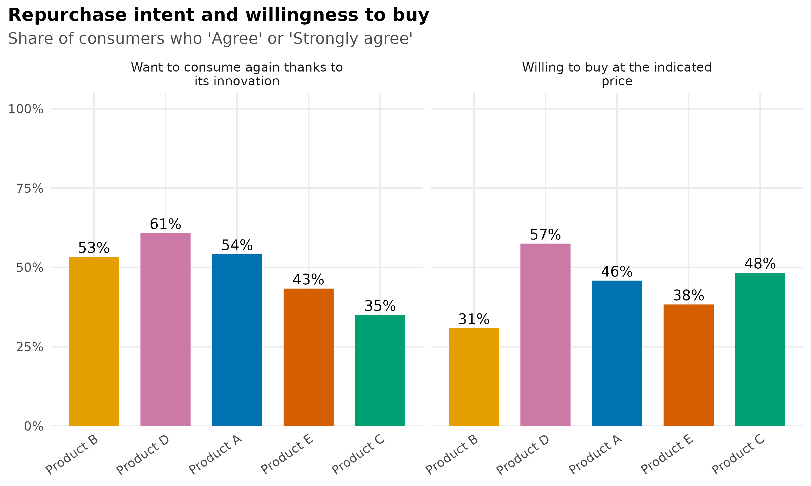
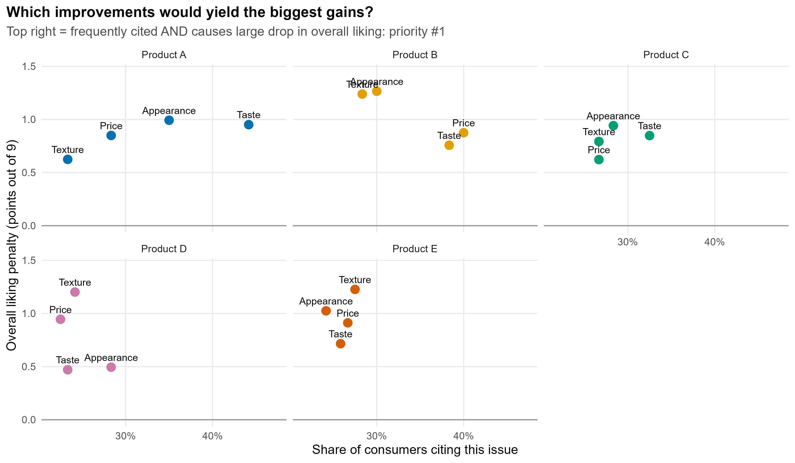
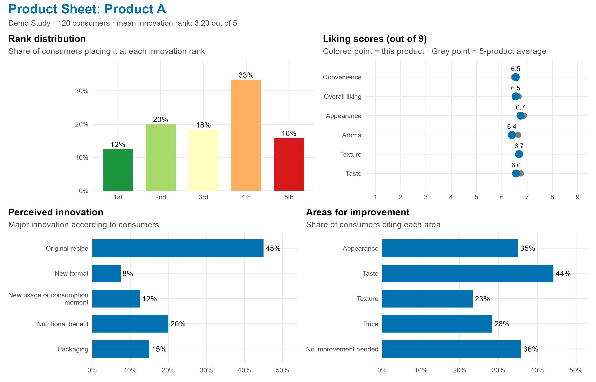

# Consumer Sensory Tasting Analysis (R)

A **reusable** R pipeline that transforms raw exports from sensory tasting software (FIZZ) into statistical analyses, stakeholder-ready visualizations for non-specialists, and one-page product sheets.

> **All data in this repository is fictional** (5 imaginary products, 120 simulated judges/consumers).  
> This pipeline was developed for Isogone, an agri-food innovation competition run by students of Institut Agro Rennes-Angers: 5 products tasted by ~120 consumers, ranking products from most to least innovative, followed by evaluation questions on liking, repurchase intent, and areas for improvement.

## The Problem

Comparing 5 very distinct products evaluated by the same consumers in a balanced, varied order, and identifying which product is perceived as most innovative, **without over-interpreting** sample noise. Reports must be easily interpretable by participating food companies who are not statisticians.

## What the Pipeline Does

```
FIZZ export (.xlsx / .ods)
        │   R/01_prepare_data.R        cleaning, validation, label dictionaries
        ▼
2 clean CSV files  (1 row = 1 judge × 1 product  +  final ranking)
        │   R/02_analysis.R            statistics, figures, product sheets
        ▼
PNG figures · product sheets · statistical test reports
```

Outputs (in `<study_folder>/outputs/`): PNG figures, one-page product sheets, and tables, including `key_figures_by_product.csv` (one row per product: rank, significance group, scores, % agreement, perceived innovation, areas for improvement, plus a mean row) to fill in the written reports quickly.

Everything that changes from one study to another (sheet names, response labels, products, plot titles) is isolated in a **single configuration file** (`demo/config.R`): scripts do not need modification for a new edition.

## Results on Simulated Data

**Who are the consumers?** A one-glance description of the panel (occupation, age, gender), to place at the start of every report so that readers know whose opinion the results represent.



**Which product is the most innovative?** Mean score and 95% uncertainty margin (bootstrap by judge). Here, Product B comes out on top in 98% of resamples.



**What consumers appreciated.** Linear mixed-effects model with post-hoc significance letters: two products sharing a letter are not significantly different.



**Repurchase intent and willingness to buy.**



**What should be prioritized for improvement?** Penalty analysis: an issue cited frequently that causes a large drop in overall liking (top-right quadrant) is a top priority.



**Product Sheet** (one per product, ready for participating companies).



## Statistical Methods

| Question | Method | Rationale |
|---|---|---|
| Which product is ranked most innovative? | Friedman test, pairwise comparisons (paired Wilcoxon, Holm correction), consumer-level bootstrap | Ranks are ordinal and the same judges evaluate all products |
| Score confidence interval | Bootstrap: resampling **judges**, not individual ratings | Ratings from the same judge are not independent |
| Liking /9 by criterion | Mixed-effects model `rating ~ product + serving_order + (1 \| judge)`, Tukey comparisons | Judge random effect controls for strict/lenient raters; serving order controls for presentation bias |
| Repurchase intent, price | % "agree" (top-2 box), Cochran's Q test | Binarized responses, repeated measures |
| Perceived innovation | Distribution across products, Chi-square test (indicative) | Categorical variable |
| Areas for improvement | Frequencies and penalty analysis | Prioritizing product reformulations |
| Experimental design | 5-product Williams Latin square design (10 sequences) | Balances order and first-order carryover effects |

The data preparation script matches labels regardless of case, accents and question-number prefixes (`4-Strongly agree` = `Strongly agree`), stops with an explicit message listing any unknown label, verifies that each judge tasted and ranked all products, excludes incomplete judges, and displays the balance across serving positions.

## Core Skills Demonstrated

Statistics for sensory evaluation (experimental design, mixed-effects models, non-parametric methods, bootstrapping) · R programming (`tidyverse`, `lme4`, `emmeans`, `ggplot2`, `patchwork`) · Data wrangling of non-standard software exports · Data storytelling and visualization for business stakeholders · Clean, reusable, and documented code.

## Running the Demo

From the repository root (R working directory = root):

```r
install.packages(c("tidyverse", "lme4", "lmerTest", "emmeans", "multcomp",
                   "multcompView", "patchwork", "scales", "readxl", "writexl"))

source("R/00_simulate_fizz_export.R")   # (optional) regenerates fictional export
source("R/01_prepare_data.R")          # export -> 2 clean CSV files
source("R/02_analysis.R")              # statistics, figures, and sheets in demo/outputs/
```

The mock export (`demo/data/fizz_export_mock.xlsx`) is pre-generated: steps 1 and 2 can be run directly.

## Using the Pipeline for a Real Study

1. Copy `demo/` to `my-study/` and place the FIZZ export into `my-study/data/`.
2. Adapt `my-study/config.R`: `study_folder`, `export_file`, `product_names`, and labels if questionnaire differs.
3. Update `source("…/config.R")` at the top of `R/01_prepare_data.R` and `R/02_analysis.R` to point to the new folder.
4. Run both scripts. If an unrecognized label appears in the export, the script halts and lists the items to add to `config.R`.

To read `.ods` exports, also install `readODS`.

## Limitations and Future Directions

- Formal carryover effect testing is not yet implemented: serving order is currently included as a fixed covariate in the liking model.
- 5-point scales are analyzed using top-2 box percentages; cumulative link mixed models (CLMM) would provide a natural extension.
- Open-ended qualitative comments are not parsed (manual thematic coding in the original competition).
- Results from a panel predominantly composed of young students do not generalize to the broader consumer population.

## License

Code released under the MIT License (see `LICENSE`).
